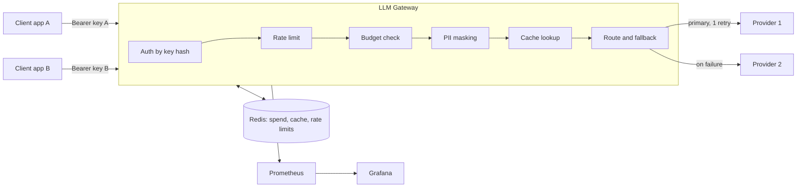

# Architecture

## Request path

1. **Auth.** The API key is hashed (SHA-256) and matched to a client (tenant). Keys are never stored in plain text.
2. **Rate limit.** A fixed one-minute window per client, kept in Redis, so all replicas share it.
3. **Budget.** Monthly spend per client is stored in Redis as integer micro-dollars. At or above the budget the gateway answers 402 and does not call any provider. A Prometheus alert fires at 50%.
4. **PII masking** (per client, optional). Emails and phone numbers with 9 or more digits become `[EMAIL]` and `[PHONE]` before the prompt leaves the gateway.
5. **Cache** (per client, optional). The key covers the client, route, messages, temperature and max tokens. A hit costs nothing and skips the provider.
6. **Route.** A route is a name clients call as `model`. It maps to an ordered list of provider targets. The first one is tried twice (one retry), then the next ones once each. Auth errors (401, 403) skip the retry but still fall back.
7. **Accounting.** Tokens come from the provider's usage field. Cost is calculated from the price table in the config.

## Decisions and limits

- **One worker per container.** `prometheus_client` metrics live in process memory, so more workers per container would split the counters. Scale with replicas.
- **State in Redis only.** The gateway itself is stateless, so it can run on 2 or more replicas. Redis is a single point of failure unless you use a replicated one (the AWS module uses ElastiCache with failover).
- **Fixed-window rate limit** allows short bursts at window edges (up to twice the limit across a boundary). It is simple and cheap. A sliding window would be the next step.
- **Budget check is not atomic.** Two concurrent requests can both pass the check near the limit, so a client can overshoot the budget by a few requests. The spend is still recorded exactly.
- **No streaming yet.** Requests with `stream: true` are rejected with 400.
- **Config file, not a database.** Tenants live in one YAML file. Changing it needs a deploy. For 5 to 50 clients this is fine.
- **Cost is calculated, not billed.** The numbers come from token counts and your price table. They will differ slightly from the provider invoice, for example for cached-prompt discounts the gateway does not know about.

## Deployment targets

| Target | Status |
|---|---|
| docker compose (`make up`, `make demo-up`) | Run and tested |
| Kubernetes via Helm (`deploy/helm/llm-gateway`) | Deployed, smoke tested, failed upgrade and rollback tested on kind in CI |
| AWS via Terraform (`infra/aws`) | Written and validated in CI. **Never applied.** Expect to adjust it before the first real deployment |
